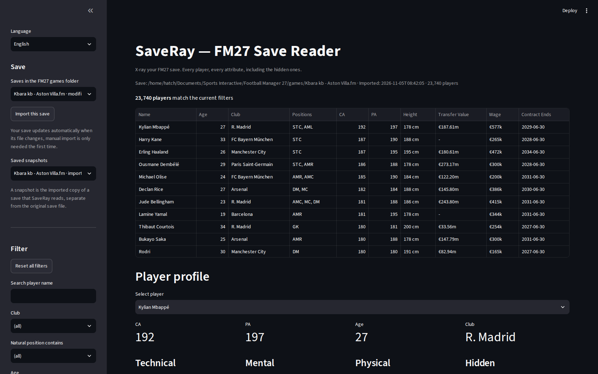
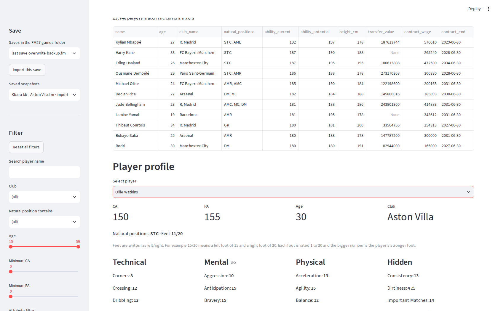
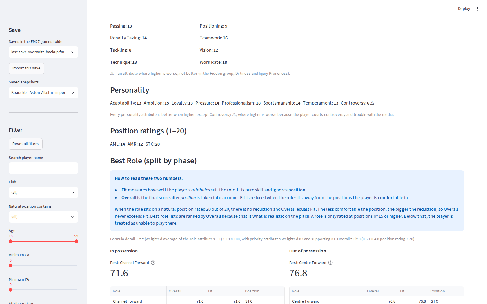
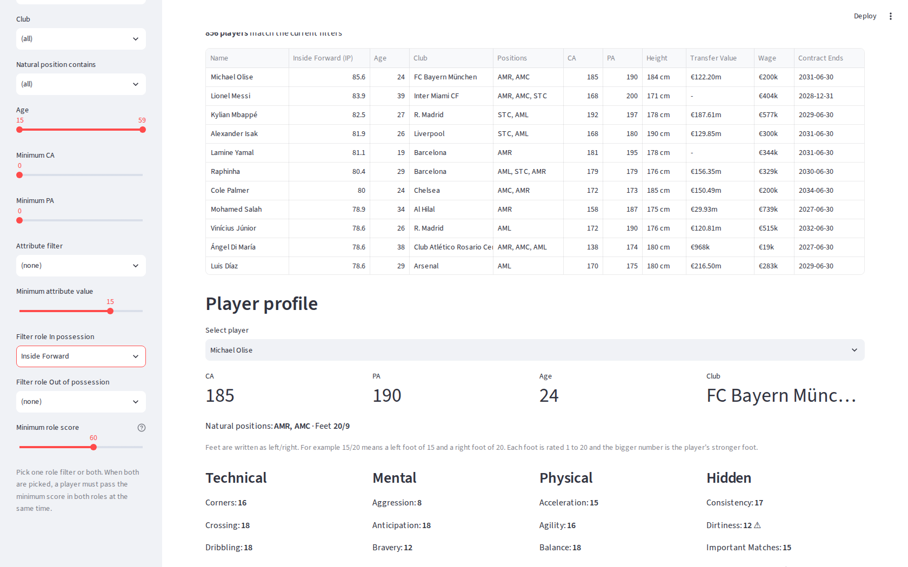
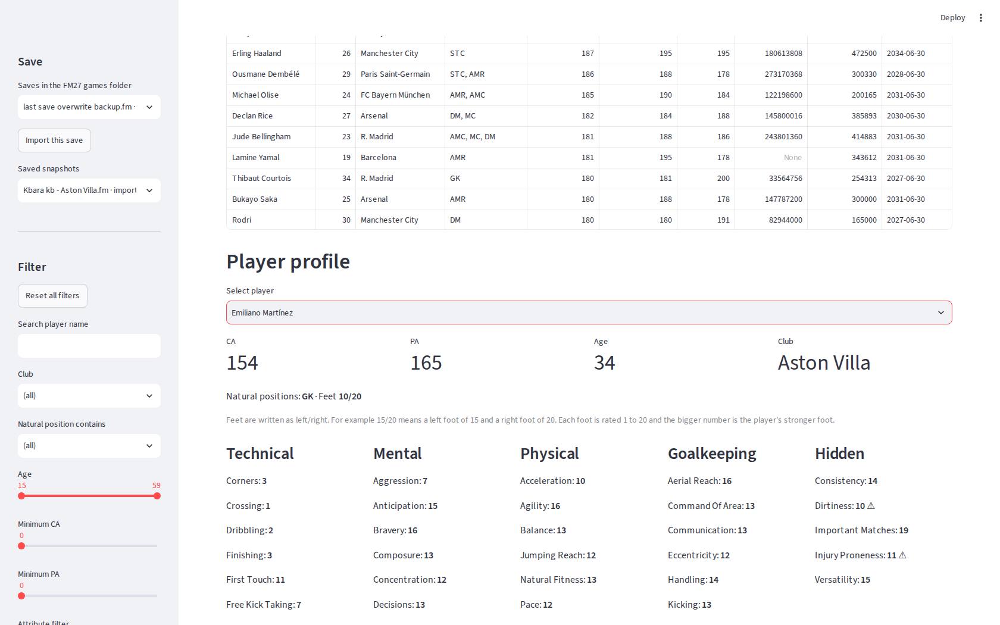
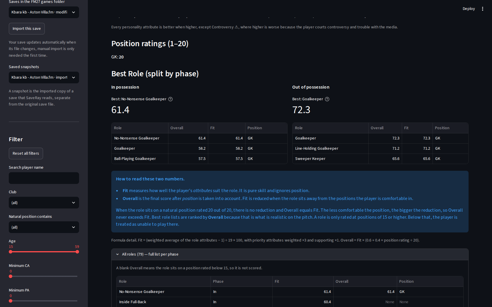

# SaveRay — FM27 Save Reader

X-ray your Football Manager 27 save. SaveRay reads an FM27 save file
(.fm) on your own computer and shows **every player in the save** with
**every attribute, including the hidden ones**, plus a **best role
rating for both phases of play**, in possession and out of possession.

Everything runs locally. Your save never leaves your machine.

## Features

- Reads a whole FM27 save through the open source
  [fmsave](https://github.com/rhiever/fmsave) parser and stores it as a
  permanent local snapshot (SQLite)
- Full player table for the entire save database, about 24,000 players
  on a typical save, with search and filters for name, club, natural
  position, age, CA and PA, any single attribute, and role fit
- Player profiles with attributes grouped by Technical, Mental,
  Physical, Goalkeeping (goalkeepers only) and Hidden, plus all eight
  personality attributes
- Best role shown **separately for each phase**, with a top 5 per phase
  and the complete list of all 78 FM27 roles, because a mixed top 3 can
  bury a player's best in-possession role completely
- Two role filters in the sidebar, one per phase, usable together so
  you can search for players who fit one role when your team attacks
  and another role when it defends
- In-app save manager. Import any save from your FM27 games folder
  with one click, keep every imported save as a named snapshot, and
  switch between snapshots without re-importing
- One-click filter reset, plain-language explanations of every score
  inside the app
- Dark theme by default, pinned in `.streamlit/config.toml`, so the
  app looks the same on every machine
- Bilingual interface, English by default with an Indonesian option
  in the sidebar, because SaveRay is made in Indonesia
- Watches the FM27 games folder and loads the newest save
  automatically when its file changes, no manual re-import needed
- Fast where it matters, imports read the save directly with no
  intermediate export step, and the role filters score the whole
  database in a fraction of a second

## Screenshots

The player table with the save manager and filters in the sidebar.



A player profile with its attribute groups, taken from an Aston
Villa save.



The Best Role section with its explanation box and the best role
for each phase.



A role filter in action, the table sorted by the fit column it
adds.



A goalkeeper profile, where the Goalkeeping group joins the other
attribute groups.



The complete list of all 78 roles for one player, opened from the
expander under the top 5 tables.



## Requirements

- Windows 10 or 11
- Python 3.11 or newer, 3.12 recommended
  (tick **Add python.exe to PATH** during Python setup)
- Football Manager 27 and at least one save file

Save parsing support depends on the game build. SaveRay is developed
and verified against FM27 build **27.0.0+2486695**, the build fully
registered by fmsave. Other builds may open as unverified, and field
meanings in a brand new game version can shift, so always sanity check
a few players against the game itself.

## Install

1. Download this repository (Code, Download ZIP) and extract it
   anywhere, or clone it with git.
2. Double-click **Install SaveRay.bat**. It creates a private Python
   environment in the project folder, installs the requirements, and
   puts two shortcuts on your desktop. This takes a few minutes.
3. Double-click the **SaveRay** desktop shortcut. Your browser opens
   the app at http://localhost:8501.
4. In the left sidebar, open the **Save** menu, pick your save from
   the FM27 games folder, and click **Import this save**. Importing
   takes about 10 seconds per save.

Use the **SaveRay - Stop** shortcut to stop the local server. Starting
SaveRay again later reopens the last snapshot you used.

To update later, download the new version over the old folder and run
**Install SaveRay.bat** again. Your snapshots live in the `snapshots`
folder and are never touched by the installer.

## How the best role score works

Each of the 78 roles has a set of priority attributes and supporting
attributes per phase. Two numbers are shown for every role.

- **Fit** is pure attribute fit. It is the weighted average of the
  role's attributes, priority counting three times and supporting
  once, converted to a 0 to 100 scale.
- **Overall** is Fit adjusted for position familiarity. Overall equals
  Fit when the role sits on the player's natural position at 20 out of
  20, and drops as the position rating falls, following
  Overall = Fit × (0.6 + 0.4 × position rating ÷ 20). Roles are only
  rated at positions of 15 or higher.

Best role lists are sorted by Overall and always split by phase. CA
and PA are displayed openly in the app but never enter the role
formula.

The role catalog is a single data file, `roles_touchline.json`, and
can be replaced without touching the engine. See `NOTICE.md` for where
its attribute groupings come from.

## Privacy

SaveRay is fully local and offline after installation. It has no
accounts, no analytics, and no network calls of its own. Your save
files and snapshots stay in the project folder on your computer, and
the included `.gitignore` keeps them out of any git commit.

## Project layout

- `app.py` — the Streamlit application
- `import_save.py` — turns a .fm save (or an fmsave CSV export) into
  a SQLite snapshot
- `roles_engine.py` — the best role scoring engine
- `roles_touchline.json` — the 78-role catalog as replaceable data
- `.streamlit/config.toml` — pins the dark theme as the default
- `install.ps1` and `Install SaveRay.bat` — the one-time installer
- `start-saveray.ps1`, `stop-saveray.ps1`, `make-shortcuts.ps1` —
  desktop shortcut plumbing
- `test_app.py` — headless smoke and behaviour tests built on
  Streamlit AppTest

## Development

With the environment installed, run the tests before changing the UI.

```powershell
.venv\Scripts\python.exe test_app.py
```

The suite renders the app headlessly and checks the best role
section, the per-phase role filters against real data, the filter
reset cycle, the goalkeeping group toggle, and the import controls.

## License

MIT. Save parsing is provided by fmsave under its own MIT license,
and the role catalog attribution lives in `NOTICE.md`. SaveRay is an
unofficial fan tool and is not affiliated with Sports Interactive
or SEGA.
